<div align="center">


<br/>

[](https://sohamsawalakhe.space)
[](https://www.linkedin.com/in/soham-sawalakhe-901366278/)
[](mailto:sohamsawalakhe@gmail.com)


</div>

---

## About Me

I'm a backend-leaning full-stack developer. At **Sitarahub** I build the plumbing behind ERP, WhatsApp communication, lead management and event platforms: REST APIs, job queues, S3 media pipelines and real-time inboxes. Outside work I dig into ML, data analytics and security.

<div align="center">

</div>

```ts
const soham = {
  role:       "Backend Developer @ Sitarahub",
  based:      "Mumbai, India",
  daily:      ["Node.js", "TypeScript", "Express", "Prisma", "PostgreSQL"],
  frontend:   ["React", "Next.js", "Tailwind CSS"],
  infra:      ["AWS S3", "CloudFront", "Redis", "BullMQ", "Docker"],
  exploring:  ["System design", "Deep learning", "Distributed processing"],
  education:  "B.Tech Computer Engineering, GCOE Yavatmal (8.2 CGPA)",
  published:  "Scopus-indexed paper on Covert Data Intelligence",
  approach:   "Build it properly, understand why it works, improve it.",
};
```

---

## Experience

**Backend Developer** · Sitarahub &nbsp;`Jan 2026 – Present` &nbsp;Mumbai

> Backend for ERP, CRM, WhatsApp and business platforms. REST APIs and DB workflows on Node.js, TypeScript, Prisma and PostgreSQL. AWS S3 media pipelines (compression, bulk uploads, filtering, pagination). Real-time inbox over WebSockets. Auth, reliability and production debugging.

**Full-Stack Developer Intern** · TechElevare &nbsp;`Aug 2025 – Dec 2025` &nbsp;Pune

> Responsive UIs and reusable React components. Node.js and Express APIs backed by MySQL. Python and Scikit-learn features inside app workflows. Agile delivery with the team.

---

## Featured Projects

#### GPSERP &nbsp;·&nbsp; WhatsApp ERP & marketing automation
Built on the official Meta WhatsApp Business Cloud API. Bulk campaigns through BullMQ queues, webhook processing and delivery tracking, a real-time inbox, leads, templates and catalogs, multi-tenant with role-based access.

      

#### IGTF &nbsp;·&nbsp; B2B trade fair platform
Connects exhibitors, investors, franchisors and visitors. Registrations, stalls, leads and payments with a central admin for organizers. Built for 400+ exhibitors and 6,000+ buyers across 16 sectors.

    

#### Darzi &nbsp;·&nbsp; Garment alteration marketplace
On-demand alterations from verified local studios. Geo-dispatch with an expanding search radius, a 9-stage order lifecycle, OTP-based pickup verification, transparent pricing and live order tracking.

    

#### Covert Database Detection &nbsp;·&nbsp; Research desktop app
Finds hidden data and concealed databases using steganography and cryptography-based detection, Alternate Data Streams and file-chunk analysis, with ML assistance and a Tkinter UI.

  

**More:** `AnySearch` desktop file search (Python, Tkinter) · `Library Management System` (Django, DRF, MySQL)

---

## Tech Stack

<div align="center">


<br/>


</div>

<br/>

| | |
| :-- | :-- |
| **Languages** | TypeScript, JavaScript, Python, SQL, HTML, CSS |
| **Backend** | Node.js, Express, Django REST Framework, FastAPI, WebSockets, BullMQ |
| **Frontend** | React, Next.js, Tailwind CSS |
| **Data & infra** | PostgreSQL, MySQL, Redis, Prisma, AWS S3, CloudFront, Docker |
| **AI / ML & analytics** | Pandas, NumPy, Scikit-learn, Matplotlib, Seaborn, Power BI |
| **Tools** | Git, GitHub, Postman, VS Code |

---

## GitHub Analytics

<div align="center">


</div>

---

## Contribution Snake

<div align="center">
<picture>
  <source media="(prefers-color-scheme: dark)" srcset="https://raw.githubusercontent.com/SohamSawalakhe/SohamSawalakhe/output/github-contribution-grid-snake-dark.svg" />
  <source media="(prefers-color-scheme: light)" srcset="https://raw.githubusercontent.com/SohamSawalakhe/SohamSawalakhe/output/github-contribution-grid-snake.svg" />
  
</picture>
</div>

---

## Certifications


## Achievements

- Published a **Scopus-indexed** research paper on Covert Data Intelligence and secure information hiding
- Solved **100+** coding and algorithmic problems
- Core software development member with ownership of project decisions, from build to deployment
- Academic hackathons, Class Representative and NSS volunteer

## Currently Exploring

`System design` · `API performance` · `Docker & AWS` · `Deep learning` · `AI-powered apps` · `Real-time & distributed processing`

---

<div align="center">

### Let's talk

Software engineering, backend architecture, AI/ML, interesting projects or roles. My inbox is open.

[](mailto:sohamsawalakhe@gmail.com)
[](https://www.linkedin.com/in/soham-sawalakhe-901366278/)
[](https://sohamsawalakhe.space)

<sub><i>Building today. Learning continuously. Engineering tomorrow.</i></sub>


</div>
